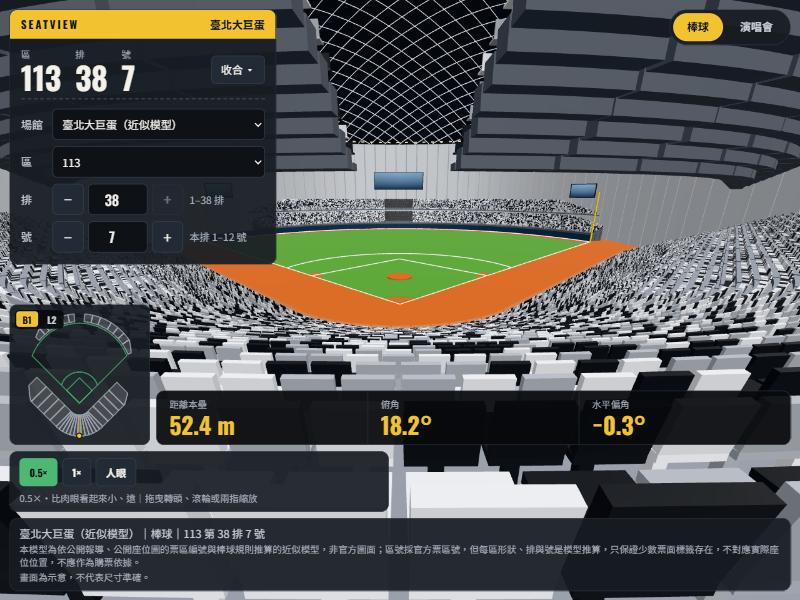
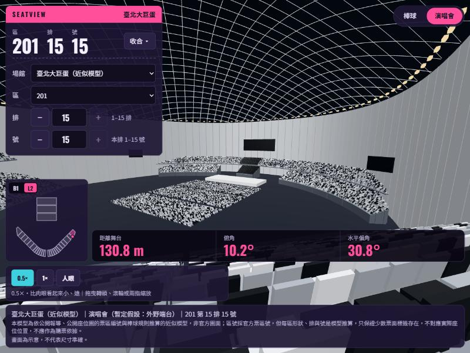

# SeatView：3D 座位視野模擬器

輸入「區、排、號」，看從該座位望向舞台（演唱會）或本壘板（棒球）的 3D 視野，並顯示距離、俯角與水平偏角。核心計算是與 three.js 無關的純函式，網頁與 MCP server 共用同一套算式。

線上 demo：https://benevolent-sfogliatella-3ed179.netlify.app




> **免責聲明**：臺北大巨蛋是依公開報導、公開座位圖與棒球規則推算的**近似模型**，非官方圖面。區號採官方票區號，但每區形狀、排與號是模型推算，只保證少數票面標籤存在。畫面為示意，**不可作為購票依據**。

## 快速試用

需要 Node 22 以上（MCP server 需要 ≥ 22.18），瀏覽器需支援 WebGL。

```bash
git clone https://github.com/jaychang940405/seatview
cd seatview
npm install
npm run dev        # 打開 http://localhost:5173
```

用網址參數直接指定座位：

| 說明 | 網址 |
| --- | --- |
| 棒球：本壘正後方後排 | `/?venue=taipei-dome&layout=baseball&section=113&row=38&seat=7` |
| 棒球：二層 | `/?venue=taipei-dome&layout=baseball&section=212&row=10&seat=3` |
| 演唱會：二層側面 | `/?venue=taipei-dome&layout=concert&section=201&row=15&seat=15` |
| 示範場館（預設） | `/` |

介面上也可以用左上角的面板輸入區、排、號，或點小地圖選位；右上角切換場館與 layout（棒球／演唱會）；拖曳可轉頭，下方按鈕可切換 0.5× / 1× / 人眼視野倍率。

## 指令

| 指令 | 用途 |
| --- | --- |
| `npm run dev` | 開發伺服器 |
| `npm test` | 單元測試（Vitest） |
| `npm run typecheck` | TypeScript 型別檢查 |
| `npm run build` | 建置（輸出到 `dist/`，純靜態網頁） |
| `npm run mcp` | 啟動 MCP server（stdio） |
| `npm run sensitivity` | C 級參數的敏感度分析 |

## MCP server（Bonus）

把座位視野查詢包成 5 個唯讀 tool，讓 AI 助理直接呼叫：`list_venues`、`list_sections`、`get_seat_view`、`compare_seats`、`get_venue_provenance`。

Claude Code：

```bash
claude mcp add seatview -- node /你的路徑/seatview/src/mcp/main.ts
```

Claude Desktop：在 `claude_desktop_config.json` 加入

```json
{ "mcpServers": { "seatview": { "command": "node", "args": ["/你的路徑/seatview/src/mcp/main.ts"] } } }
```

接上後可以直接問：「臺北大巨蛋棒球，113 區 38 排 7 號的視野如何？」。詳細的 tool 說明與錯誤代碼見 [docs/mcp.md](docs/mcp.md)。

## 架構

```
src/venues/*.json  場館資料（區、layouts；每個 layout 有自己的 focus 與 overlays）
src/core/          純函式：schema 驗證、座位位置、相機、距離與角度（不依賴 three.js 與 DOM）
src/render/        three.js 場景，只負責畫，不做計算
src/ui/            區／排／號面板、小地圖、網址參數
src/mcp/           MCP server，只使用 src/core
```

新增一個配置（例如棒球）只需要新增 layout 與 overlay，不改動 `core` 的函式簽名。

## 文件

- [docs/ai-log.md](docs/ai-log.md)：AI collaboration log（日期、問題、AI 建議、我的取捨）
- [docs/venue-taipei-dome.md](docs/venue-taipei-dome.md)：大巨蛋模型的數字來源與 A／B／C 等級
- [docs/manual-checks.md](docs/manual-checks.md)：人工目視檢查清單與截圖
- [docs/sensitivity.md](docs/sensitivity.md)：C 級估算參數的敏感度分析
- [docs/mcp.md](docs/mcp.md)：MCP server 說明

## 授權與資料來源

- 不使用 twconcertview.com 的任何程式碼、3D 模型或圖片，所有場館資料與模型皆自行建立。
- 臺北大巨蛋外框摘要來自 © OpenStreetMap contributors（ODbL）；repo 只放擬合後的外框，不放原始座標。
- 第三方程式庫：three.js（MIT）、`@modelcontextprotocol/sdk`（MIT）、zod、Vite、Vitest。
